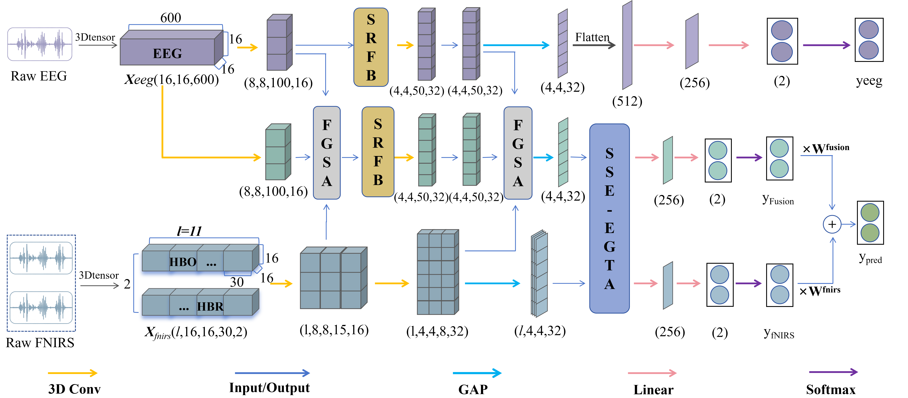
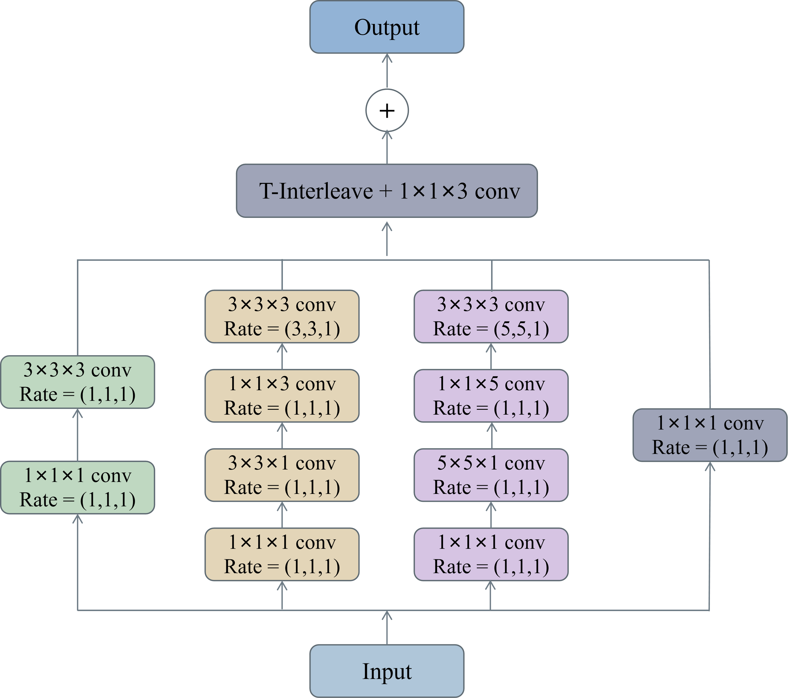
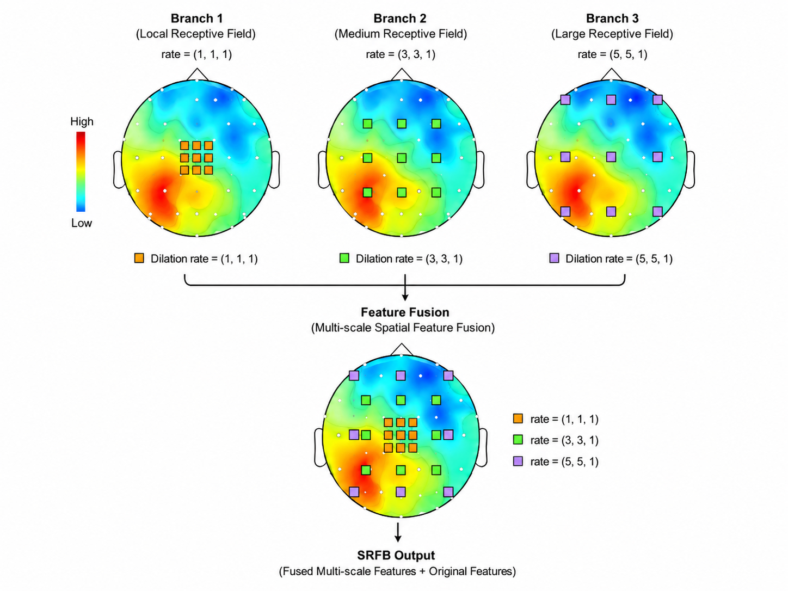
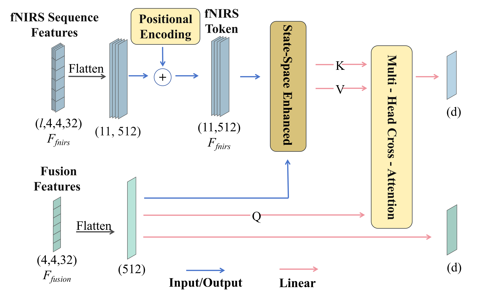
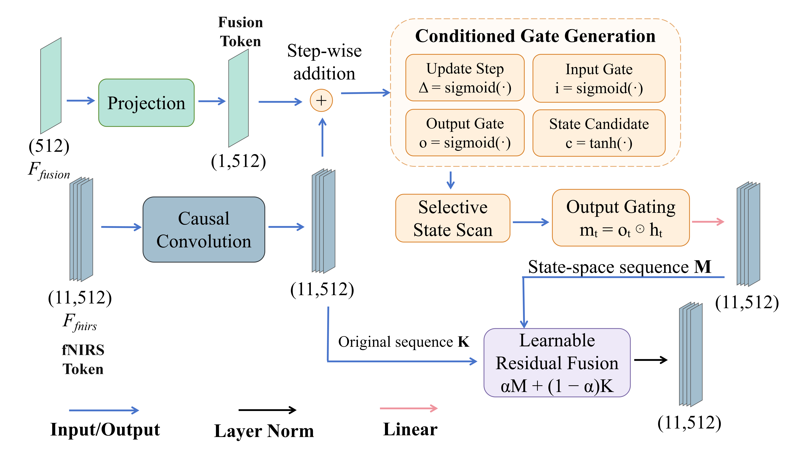

# RSMTA-Net

TensorFlow implementation of **RSMTA-Net: A Receptive-Field Spatial Modeling and State-Space Temporal Alignment Network for Hybrid EEG-fNIRS Decoding**.

RSMTA-Net combines spatial receptive-field modeling with state-space enhancement of fNIRS candidate features before EEG-guided temporal attention. This repository contains separate implementations for motor imagery (MI), mental arithmetic (MA), and word generation (WG).

## Model architecture

<p align="center">
  
</p>

<p align="center"><sub><b>Figure 1.</b> Framework of RSMTA-Net. EEG and fNIRS are encoded by parallel 3D convolutional streams. SRFB strengthens the intermediate spatial representations, and SSE-EGTA refines the ordered fNIRS delay tokens before EEG-guided temporal alignment.</sub></p>

RSMTA-Net takes an EEG tensor `X_EEG ∈ R^(16×16×600)`, eleven fNIRS delay candidates `X_fNIRS ∈ R^(11×16×16×30×2)`, and a Fusion branch derived from both modalities. FGSA uses fNIRS-derived spatial attention to guide the Fusion representation at two extraction depths, while SRFB enlarges the spatial receptive field of the EEG and Fusion features between them. The pooled fNIRS sequence is then refined by Fusion-conditioned state-space enhancement and aligned with the Fusion query through multi-head cross-attention (SSE-EGTA). The final prediction combines the Fusion and fNIRS outputs; the EEG output is retained as an auxiliary prediction.

### SRFB: multi-scale spatial receptive-field block

<p align="center">
  
</p>

<p align="center"><sub><b>Figure 2.</b> Framework of SRFB. Three parallel branches use dilation rates (1,1,1), (3,3,1), and (5,5,1); a residual path preserves the input.</sub></p>

SRFB processes the intermediate EEG and Fusion features before the second FGSA stage. The three branches capture local, medium-range, and broad spatial dependencies, and `T-Interleave + 1×1×3 conv` fuses them with the residual input. Dilation is applied only along the two spatial axes.

<p align="center">
  
</p>

<p align="center"><sub><b>Figure 3.</b> Receptive-field coverage of the three SRFB branches and their multi-scale fusion. The scalp map is illustrative; colors do not represent measured cortical activation.</sub></p>

### SSE-EGTA: state-space enhancement and temporal alignment

<p align="center">
  
</p>

<p align="center"><sub><b>Figure 4.</b> Framework of SSE-EGTA. Fusion-conditioned SSE refines the ordered fNIRS tokens into enhanced keys and values for EGTA cross-attention.</sub></p>

The eleven fNIRS candidates are flattened and augmented with positional encodings. Fusion-conditioned gates update the state along the delay sequence, and a learnable residual fusion combines the state-space context with the original tokens. EGTA then uses the Fusion representation as the query to select delayed fNIRS information.

<p align="center">
  
</p>

<p align="center"><sub><b>Figure 5.</b> State-space enhancement within SSE-EGTA. Fusion-conditioned update, input, and output gates control state retention and updating; residual fusion combines the resulting context with the original tokens.</sub></p>

## Repository structure

```text
figures/                        Architecture and receptive-field figures used in this README
RSMTA-MI/
  sta.py                         Model definition; factory: sta_net()
  run_sta_net.py                 MI training and evaluation
  run_time_window_accuracy.py    Optional MI time-window experiment
RSMTA-MA/
  sta.py
  run_sta_net.py
RSMTA-WG/
  sta.py
  run_sta_net.py
requirements.txt                Training dependency versions
SOURCE_MANIFEST.json            Source mapping and SHA-256 checksums
NOTICE.md                       Related work and source provenance
```

The task-specific Python sources retain their original absolute data paths and current subject-selection settings. Configure these settings in your own checkout before running. Data, trained weights, and generated experiment outputs are not included.

## Environment

The supplied projects target Python 3.9 and TensorFlow/Keras 2.10. Use an existing compatible TensorFlow GPU environment or create a separate environment:

```bash
python -m pip install -r requirements.txt
```

`requirements.txt` covers training and evaluation. The data-preprocessing scripts and their separate dependencies are not included in this repository; see [Data preprocessing](#data-preprocessing) for how to request them.

## Data

Obtain the recordings from their original providers and follow their access conditions:

| Task | Public dataset | Binary labels |
| --- | --- | --- |
| MI | [Open access dataset for simultaneous EEG and NIRS BCI](https://doc.ml.tu-berlin.de/hBCI/) | Left-hand versus right-hand imagery |
| MA | [Open access dataset for simultaneous EEG and NIRS BCI](https://doc.ml.tu-berlin.de/hBCI/) | Mental arithmetic versus baseline |
| WG | [Simultaneous acquisition of EEG and NIRS during cognitive tasks](https://doc.ml.tu-berlin.de/simultaneous_EEG_NIRS/) | Word generation versus baseline |

The MI/MA dataset contains 29 participants; the WG dataset contains 26. MI and MA use different sessions of the same public dataset.

### Model input

The training scripts expect one `.npz` file per participant under a task's `model_input` directory.

| Key | Shape | Meaning |
| --- | --- | --- |
| `eeg` | `(N, 16, 16, 600, 1)` | EEG spatial grids and time samples |
| `fnirs` | `(N, 11, 16, 16, 30, 2)` | Eleven fNIRS candidates; last axis is HbO/HbR |
| `label` | `(N, 2)` | One-hot binary labels |
| `sample_session` | `(N,)` | Required by MI/MA; session IDs 0, 1, 2 |

MI/MA input files also retain trial-level session metadata. The WG training script uses the original ordering of 600 windows: three consecutive sessions of 200 windows each. Each trial contributes ten EEG windows. The training scripts multiply the stored fNIRS input by `1e3`; do not apply this scaling a second time to an already scaled input.

## Train and evaluate

Run from the chosen task directory so that `from sta import sta_net` resolves to that task's model:

```bash
cd RSMTA-MI
python run_sta_net.py
```

Use the same commands from `RSMTA-MA` or `RSMTA-WG` for the other tasks. Each script starts training when executed; it is not an import-only library.

### Required local configuration

| Task | Configuration to review before execution |
| --- | --- |
| MI | Set `RAW_ROOT`. Near the bottom, enable the existing `for sub_id in MAIN_SUBJECT_IDS:` block to run participants 01–04 and 06–29. The supplied snapshot has this block commented out and enables only participant 05's two valid sessions. |
| MA | Set `RAW_ROOT`. The script processes the `.npz` files in that task's `model_input` directory. |
| WG | Set `subject_path`, the `Logger(...)` output path near the top, and the result paths in the script. Ensure parent directories exist. Keep the `model_input` directory limited to participant input files. |

For MI's complete cohort, retain the participant 05 call as well as enabling the main participant loop. Participant 05 has no valid samples in session 0 after preprocessing, so only sessions 1 and 2 are evaluated for that participant. The intended complete session-wise evaluation therefore has 86 MI folds, 87 MA folds, and 78 WG folds when all expected participants are present.

### Training settings in the supplied scripts

The outer evaluation holds out one session of the same participant. MI/MA use explicit session metadata; WG uses its original contiguous session ordering. The scripts preserve their different validation procedures: MI and WG sample validation windows from the development sessions; MA selects complete trials within those sessions.

Training uses two stages, with epoch limits of 300 and 200. The second stage continues the same model and optimizer on all development-session data, including the validation subset, while retaining validation monitoring and early stopping. Consult each task's callbacks for its exact patience and scheduling settings. MI/MA set Python, NumPy, and TensorFlow seeds to 42; WG fixes the validation sampling seed but does not set an equivalent TensorFlow model seed.

Evaluation CSVs and confusion-matrix figures are saved to the paths defined in each script. The final fused prediction is `class_output`; `eeg_output` is the auxiliary EEG prediction. The model factory keeps its historical function name `sta_net()`.

The optional MI script `run_time_window_accuracy.py` launches a separate training experiment and writes its own time-window results. It removes its previous time-window CSV at startup; use it only when rerunning that experiment intentionally.

## Related work

Please acknowledge the original dataset publications and relevant methodological work when using this implementation. The alignment methodology is related to *STA-Net: Spatial–temporal alignment network for hybrid EEG-fNIRS decoding*, Information Fusion (2025), article 103023: [publisher page](https://www.sciencedirect.com/science/article/pii/S156625352500096X). See [NOTICE.md](NOTICE.md) for the source mapping.

The RSMTA-Net manuscript title is provided above; a final publication DOI is not assigned in this snapshot.

## Data preprocessing

This repository distributes the model and training code only. The data-preprocessing scripts are not included. If you need them, please contact the author by email at [250854042021@lyu.edu.cn](mailto:250854042021@lyu.edu.cn).
